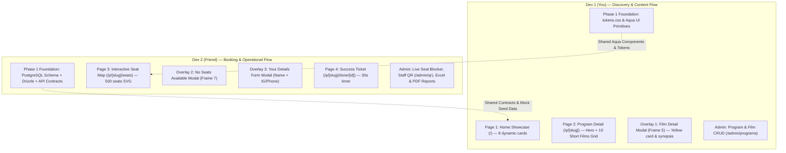
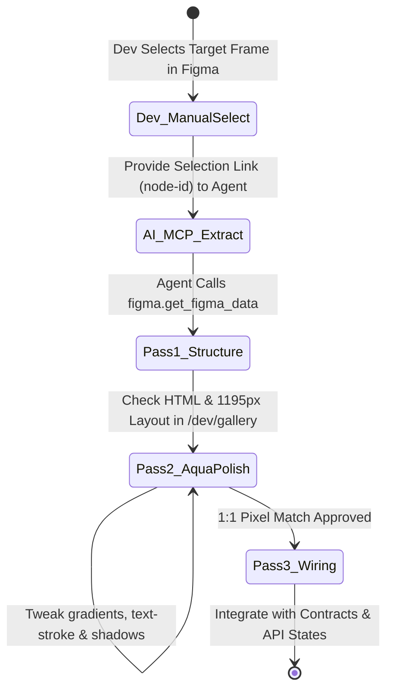
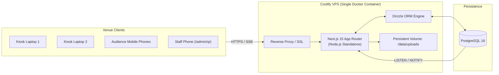
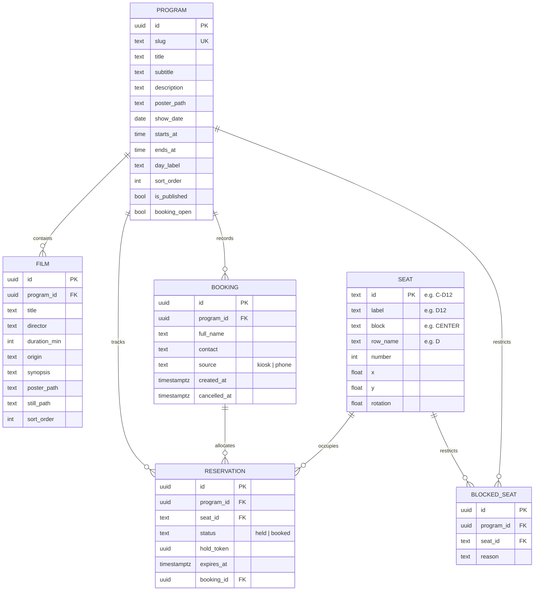
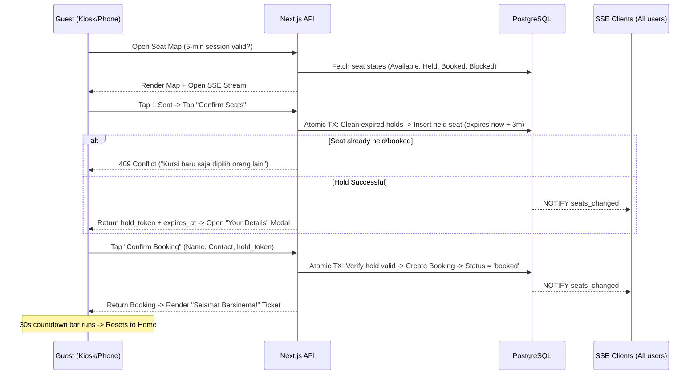

# KNF26 Ticketing: Definitive Project Plan (FINAL)

> [!IMPORTANT]
> **Source of Truth**: This document represents the 100% finalized, end-to-end plan for the KNF26 Ticketing Website. Every single previous assumption has been replaced with your explicit decisions through the `/grill-me` design audit.

---

## 1. Master Decisions Register (100% User-Decided)

| # | Topic | Locked Decision | Concrete Specification |
|---|---|---|---|
| 1 | **Ticket Cost** | **Free Reservation** | No payment gateway (Midtrans/Xendit/QRIS). Free seat reservation only. |
| 2 | **Event Scale** | **1 Hall, ~500 Seats, 8 Programs** | 1 venue with ~500 seats (`SEAT.png`). 4 screenings/day across 2 festival days = **8 distinct programs total**. Each program has its own unique film line-up. |
| 3 | **Seat Limit** | **Strictly 1 Seat Per Person** | Each transaction is limited to **exactly 1 seat**. Matches `form overlay.png` (`YOUR SEAT: A1`) and the ticket card (`SEATS: A1`). |
| 4 | **Venue Access & Gate** | **Staff-Displayed QR Code** | Attendees scan a dynamic QR displayed on a staff phone (`/admin/qr`) to unlock a **5-minute booking session** on their mobile device. No user login, no OTP. |
| 5 | **Concurrency & Hold** | **3-Minute Atomic Hold** | Tapping *Confirm Seats* locks the chosen seat in PostgreSQL for **3 minutes**. Broadcast live via Server-Sent Events (SSE). Automatically released if the form is abandoned. |
| 6 | **Proof of Ticket** | **Screenshot Ticket Card** | Audience screenshots the final *"Selamat Bersinema!"* ticket card. Staff checks the screenshot at the door. No digital barcode scanners, no QR scanners. |
| 7 | **Ticket Screen Reset** | **30 Seconds (All Devices)** | On **all devices** (kiosk laptops, tablets, and mobile phones), the success screen displays the 30-second countdown progress bar before resetting to Home, giving ample time to screenshot. |
| 8 | **Kiosk Inactivity Reset** | **2 Minutes Idle Timeout** | If an attendee walks away from a kiosk laptop mid-flow (e.g. at the seat map or form), the laptop automatically resets back to Home after **2 minutes of inactivity** and releases any held seat. |
| 9 | **Sold-Out Flow** | **Browse Allowed, Modal on CTA** | Tapping a "SOLD OUT" program card on Home still opens the Program Detail page so attendees can read film synopses. Tapping `Choose Seat →` pops open the *No Seats Available* modal (`Frame 7`). |
| 10 | **Film Line-up Count** | **Vertical Page Scroll** | The sub-header *10 SHORT FILMS* is supported by natural vertical page growth: the 3-column film grid renders all films in the lineup (e.g. 10 films = 4 rows of 3) without pagination. |
| 11 | **Seat Map Button States** | **Silver (Off) vs Blue (On)** | **Silver `Confirm Seats →`** = Disabled (0 seats picked).<br>**Blue glossy `Confirm Seats →`** = Active/Enabled (1 seat selected). |
| 12 | **Seat Map Overlap Fix** | **Canvas Bottom Padding** | The seat canvas receives extra bottom padding so attendees can scroll down and bring all lower-center seats completely clear of the floating summary rail. |
| 13 | **Mobile Seat Map UX** | **Horizontal Pan / Scroll** | On mobile screens, the 500-seat SVG map renders at a fixed readable scale inside a smooth horizontal scroll container with a swipe indicator. |
| 14 | **Form Contact Input** | **Freeform Validation (> 2 chars)** | `INSTAGRAM/PHONE NUMBER *` accepts any text longer than 2 characters (flexible for `@username`, phone digits, etc.) to minimize booking friction. |
| 15 | **Admin Panel Scope** | **CMS + Live Seats + Reports** | Single shared admin password. Program/film CRUD, poster uploads, live seat grid with manual seat blocker, audience list with cancel, daily reports, and exports to **Excel (`exceljs`)** and **PDF (`@react-pdf/renderer`)**. |
| 16 | **Tech Stack & Hosting** | **Next.js + Postgres on Coolify** | Next.js 15 App Router, TypeScript, Drizzle ORM, PostgreSQL 16, SSE via `LISTEN/NOTIFY`, persistent volume for media, 100% self-hosted on Coolify. |

---

## 2. Team Split: Vertical Page-by-Page Workflow

To manage the high visual fidelity of the Y2K/Windows-XP glossy Aqua styling without merge conflicts, work is divided by user journey flows:



### Detailed Ownership Breakdown

| Area | Dev 1 (You) | Dev 2 (Friend) |
|---|---|---|
| **Foundation (Week 1)** | • Global tokens (`tokens.css`)<br>• Core Aqua primitives (`GelButton`, `GlossCard`, `GlassPill`, `DisplayTitle`, `Badge`, `Modal`, `Stepper`)<br>• Visual Component Gallery (`/dev/gallery`) | • PostgreSQL 16 schema + Drizzle ORM<br>• API types & Zod schemas (`/lib/contracts.ts`)<br>• Seed script with 8 programs, 80 films, ~500 seats<br>• Dockerfile & staging Coolify deployment |
| **Public UI (Week 2)** | • **Home (`/`)**: 8 program cards, sky/grass background, live badges, top pill<br>• **Program Detail (`/p/[slug]`)**: Hero container, back pill, stepper, full vertical film grid<br>• **Film Detail Modal (`Frame 5`)**: Butter-yellow card, metadata, close `×` button | • **Seat Map (`/p/[slug]/seats`)**: SVG hall layout, bottom padding, silver/blue button states<br>• **No Seats Modal (`Frame 7`)**: Triggered from CTA<br>• **Your Details Modal**: Form dialog overlay<br>• **Success Ticket (`/p/[slug]/done`)**: Celebratory gradient, ticket card, 30s timer |
| **Logic & Engine (Weeks 2–3)** | • Wire Discovery pages to API<br>• Category filters & responsive transitions | • 3-minute atomic seat hold engine (`/lib/booking/*`)<br>• SSE live update endpoint via Postgres `LISTEN/NOTIFY`<br>• Staff rotating QR generator & 5-minute session gate |
| **Admin Panel (Weeks 3–5)** | • **Content Admin**: Program list, edit program, drag-to-reorder films, poster image uploads | • **Operational Admin**: Real-time seat grid & manual seat blocker, audience list with cancel, staff QR view (`/admin/qr`), styled Excel & PDF report exports |

> [!TIP]
> **AI Pairing Protocol**: For every UI screen and modal listed above, the assigned developer manually selects that specific frame in Figma, copies the selection link (<kbd>Ctrl</kbd>/<kbd>Cmd</kbd> + <kbd>L</kbd>), and feeds it directly to the AI agent following the [Figma MCP Operating Protocol](#32-ai-agent-operating-protocol-figma-mcp-execution). Never supply the full canvas link.

---

## 3. Iterative Multi-Pass Workflow with AI Agents

To achieve pixel-perfect fidelity (1:1) with the Y2K/Windows-XP glossy Aqua aesthetic, developers and AI agents collaborate using a strict selection-based Figma MCP protocol.



---

### 3.1 Developer Manual Frame Selection Workflow

> [!IMPORTANT]
> **Never Pass Full Canvas / Page Links (`node-id=1-3`) to the AI Agent**:
> Querying an entire Figma canvas or top-level page forces the Figma API to serialize millions of AST nodes, generating megabytes of payload. This causes context window overflow, prompt truncation, or triggers Figma REST API rate limits (**HTTP `429 Too Many Requests`**).

**How Developers Must Provide Links to the Agent:**
1. **Open the Figma Project** and navigate to the target screen, overlay modal, or isolated complex component.
2. **Select the Target Frame Manually:** Click directly on the frame's title bar (e.g. *Dialog - When the Tide Returns*, *Program Detail*, *Denah Kursi*, etc.) so only that element is highlighted.
3. **Copy Selection Link:** Press <kbd>Ctrl</kbd> + <kbd>L</kbd> (Windows) or <kbd>Cmd</kbd> + <kbd>L</kbd> (Mac), or **Right-Click $\rightarrow$ Copy link to selection**.
4. **Prompt the Agent:** Provide the selection URL (containing `?node-id=...`) and instruct the agent to extract the design data for that specific node.

---

### 3.2 AI Agent Operating Protocol (Figma MCP Execution)

When given a frame selection URL, the AI agent **must execute the following procedure**:

1. **Invoke Figma MCP Tool:**
   * Call `figma.get_figma_data` with the file key and the target `nodeId` provided in the selection URL.
   * If the frame contains images or icons, call `figma.download_figma_images` specifying the image/icon node IDs to fetch SVG vectors or high-res PNGs.

2. **Extract Complete Design Tokens & Data (1:1 Extraction):**
   * **Auto-Layout & Box Model:** Extract `mode` (`row` vs `column`), padding (`top`, `right`, `bottom`, `left`), gap spacing, `alignItems`, `justifyContent`, sizing behaviors (`hug`, `fixed`, `fill`), and exact width/height.
   * **Colors & Gradients:** Extract all fill definitions—especially multi-stop linear gradients (exact angles, color stops, and RGBA values).
   * **Typography:** Extract exact font properties for all text layers: `fontFamily`, `fontSize`, `fontWeight`, `fontStyle` (italic/normal), `lineHeight`, `letterSpacing`, and text alignment (`textAlignHorizontal`, `textAlignVertical`).
   * **Borders & Strokes:** Extract `strokeWeight`, stroke alignment, multi-stop gradient strokes (for borders/outlines), and `borderRadius`.
   * **Effects & Shadows:** Extract exact `boxShadow` definitions, inner shadows (`inset`), hard offset shadows (e.g. `textShadow`), and backdrop blur filters.
   * **Stylized Vector Typography:** For complex display titles that feature combined gradient fills and multi-stop gradient strokes with hard drop shadows, implement them as vector SVG `<text>` elements or CSS `-webkit-text-stroke` / `-webkit-background-clip: text` layers to preserve exact vector outlines.

3. **Validate in `/dev/gallery`:**
   * Mount the newly built component in the Visual Component Gallery (`/dev/gallery`) side-by-side with the design screenshot before integrating backend logic.

---

### 3.3 The 3-Pass Page Build Pipeline

1. **Pass 1: Structure & Shell**:
   - Establish DOM structure, flex/grid layouts, responsive breakpoints, and prop interfaces using mock data at 1195px reference width.
2. **Pass 2: Micro-Styling & "Aqua" Polish (Iterate 2–3 times)**:
   - Mount in `/dev/gallery` side-by-side with cropped Figma reference PNGs.
   - Refine multi-layer shadows, bevel highlights, linear gradients, `-webkit-text-stroke`, and font metrics.
3. **Pass 3: State & Contract Wiring**:
   - Connect props to `/lib/contracts.ts`.
   - Implement loading skeletons, button disabled/pressed states, error toasts, and modal animations.

---

## 4. System Architecture



* **Framework**: Next.js 15 (App Router, Standalone output).
* **Styling**: Native CSS Modules + `tokens.css` for public screens (precise Y2K styling); Tailwind v4 + shadcn/ui for Admin.
* **Database & ORM**: PostgreSQL 16 + Drizzle ORM with migration scripts.
* **Real-time Live Sync**: SSE endpoint `/api/programs/[id]/stream` consuming PostgreSQL `pg_notify('seats_changed', ...)`.
* **Media Handling**: `sharp` compressing uploads into WebP format on local disk volume.
* **Report Generation**:
  * Excel: `exceljs` with branded headers, borders, frozen header row, and totals.
  * PDF: `@react-pdf/renderer` rendering clean, high-resolution A4 festival reports.

---

## 5. Database Schema (Drizzle ORM)



> [!NOTE]
> Database integrity enforces `UNIQUE (program_id, seat_id)` on `reservation`. It is impossible for two people to hold or book the same seat at the same time.

---

## 6. End-to-End Booking Flow



---

## 7. Responsive & 1:1 Layout Rules

1. **Desktop / Kiosk Laptops (≥ 1195px)**:
   - Root layout container defaults to 1195px reference design with dynamic CSS variable scaling:
     ```css
     :root {
       --kiosk-scale: min(1, calc(100vw / 1195));
     }
     ```
   - Matches 1366×768 or 1920×1080 laptop screens in Chrome fullscreen mode (`--kiosk`).
2. **Mobile Screen Widths (< 768px)**:
   - **Home**: Program cards stack in a 1-column layout; card proportions and badges remain intact.
   - **Program Detail**: Hero section stacks poster on top, title/meta below. Film line-up adjusts to a 1-column grid.
   - **Seat Map**: Rendered at fixed touch-accessible dimensions (minimum 36×36px per seat cell) inside an `overflow-x: auto;` container with bottom padding. Displays a swipe indicator (`← Geser denah →`).
   - **Summary Rail**: Pinned to the screen bottom (`position: fixed; bottom: 0; left: 0; width: 100%;`) with backdrop blur.
   - **Ticket Screen**: Outlined ticket card renders full-width; 30-second progress bar counts down at the bottom.

---

## 8. Missing Details Checklist (To Gather During Dev)

```
[ ] Typography
    - Exact Font Families: Display font (condensed bold italic) and Sans font (body/labels).
    - Interim Google Fonts configured via CSS variables: Anton / Archivo Black (Display) + Plus Jakarta Sans (Body).

[ ] Brand Vector & Graphic Assets
    - Clean SVG of Mascot (Unicorn/Goat with Halo).
    - High-Res Title Wordmarks:
      * "Festival Programs" (currently 414x181 PNG).
      * "Selamat Bersinema!" with exclamation point (currently 432x166 PNG without "!").
    - Original uncompressed Home background photo (3840x2160, asset 941898).

[ ] Physical Hall Seat Labels
    - Map venue seat row letters and seat numbers (e.g. A1...A20) to the ~500 seats in SEAT.png.
```

---

## 9. 7-Phase Roadmap (Relative Timeline: Weeks 1 to 7)

```mermaid
gantt
  title KNF26 Development Roadmap
  dateFormat  X
  axisFormat  W%W

  section Foundation
  Phase 0 Setup & Repo Init     :p0, 0, 3
  Phase 1 Base Tokens & DB      :p1, 3, 10

  section UI Development
  Phase 2 Static 1:1 Public UI  :p2, 10, 20
  Phase 3 Booking Engine & SSE  :p3, 15, 25

  section Integration & CMS
  Phase 4 Wire-Up & Responsive  :p4, 25, 35
  Phase 5 Admin Panel & Reports :p5, 30, 42

  section Finalization
  Phase 6 Load Test & QA        :p6, 42, 49
  Phase 7 Deployment & Dry Run  :p7, 49, 52
```



* **Week 1 (Phase 0 & 1)**: Repo setup, `AGENTS.md`, Dev 1 builds `tokens.css` + Aqua primitives + `/dev/gallery`; Dev 2 builds Drizzle schema + seed data + `/lib/contracts.ts` + Coolify staging.
* **Week 2 (Phase 2)**: Dev 1 builds Home, Program Detail, and Film Detail Modal; Dev 2 builds Seat Map, No Seats Modal, Form Modal, and Success Ticket.
* **Weeks 2–3 (Phase 3)**: Dev 2 builds the 3-minute atomic hold engine, SSE streaming, and rotating staff QR gate (`/admin/qr`).
* **Weeks 3–4 (Phase 4)**: Wire up the pages to live APIs, add hold countdown, implement 30s ticket timer, 2-minute kiosk idle timeout, and mobile responsive polish.
* **Weeks 3–5 (Phase 5)**: Dev 1 builds Content Admin (`/admin/programs`); Dev 2 builds Live Seat Blocker, Audience list with cancel, and styled Excel/PDF reports.
* **Weeks 5–6 (Phase 6)**: k6 load test (500 SSE users, 200 seat requests/min), Playwright concurrency tests, kiosk laptop verification.
* **Week 7 (Phase 7)**: Production deployment on Coolify, automated hourly backups, venue Wi-Fi dry run, code freeze 48h prior to festival.

---

## 10. Event Day Runbook

1. **H-1 Day Before**: Verify database seeds, upload real film posters, test Excel/PDF exports, ensure `booking_open = false`.
2. **Doors Open**: Set `booking_open = true` via Admin. Launch the 2 kiosk laptops in Chrome kiosk mode:
   ```bash
   chrome.exe --kiosk --disable-pinch --overscroll-history-navigation=0 http://<kiosk-url>/kiosk/setup
   ```
3. **Queue Spikes**: Staff member opens `/admin/qr` on their phone; attendees scan the rotating QR code to book on their own phones (5-minute session window).
4. **Internet Fallback**: If venue Wi-Fi becomes unstable, switch kiosk laptops immediately to a staff 4G mobile hotspot. The frontend auto-reconnects to the SSE stream without losing state.
5. **Audience Lost Screenshot**: If an attendee accidentally closes their screen, staff searches their name or IG handle in the Admin Audience Table to instantly retrieve their allocated seat.
6. **Wrap-up**: At the end of each screening, staff exports the audience list. At the end of each day, export the daily festival report (Excel + PDF).
